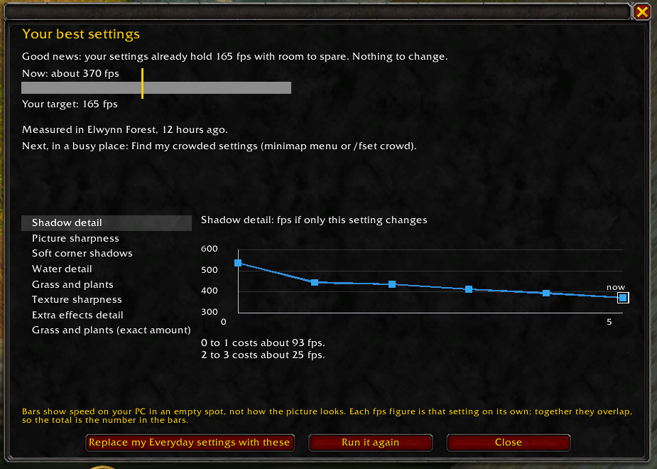
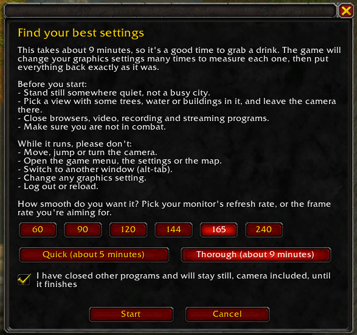
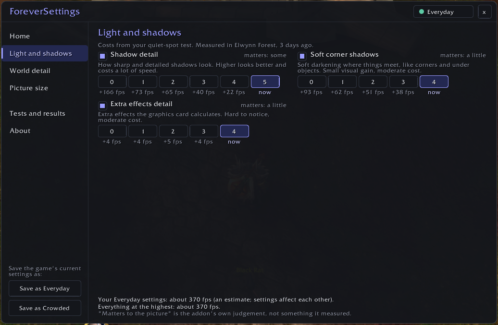
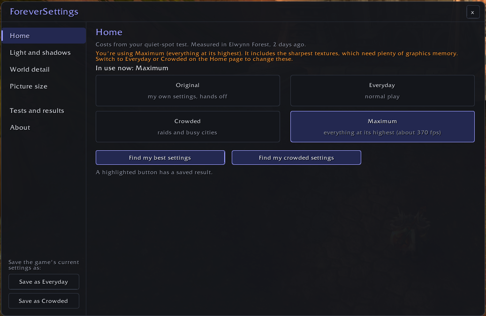
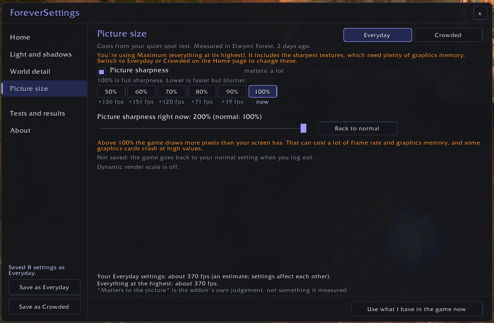
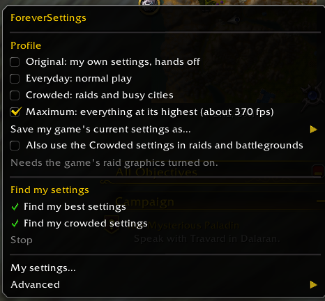

# ForeverSettings

**Not everyone has a beastmode PC. ForeverSettings finds the graphics settings that fit yours.**

<p align="center">
  
</p>

The graphics menu is a wall of sliders with names like "Compute effects" and "SSAO". Most of us either crank everything up and stutter in the busy places, or drop it all to Low and lose a beautiful game.

ForeverSettings measures *your* PC, tells you in plain words what each setting costs in frames per second, and picks settings for the frame rate you want. It shows you what you're giving up, so it's your call.

An addon for **WoW Forever**.

## Get it

- **Wago:** [addons.wago.io/addons/foreversettings](https://addons.wago.io/addons/foreversettings)
- **GitHub:** the zip on the [Releases page](../../releases/latest).
- **Install by hand:** unzip into the game's `Interface/AddOns` folder so you have one `ForeverSettings` folder (for Forever: `World of Warcraft/_forever_/Interface/AddOns/ForeverSettings`), then start the game or `/reload`. The details are in [INSTALL.md](INSTALL.md).

## Try it in four steps

1. Stand somewhere quiet and click the minimap button, then **Find my best settings**.
2. Pick the frame rate you're aiming for (your monitor's refresh rate is a good choice) and press **Start**. It takes roughly 10 to 25 minutes (Quick is the shorter) and runs on its own. Don't move or open windows while it runs.
3. See what each change does, then **Save**. Your own settings are put back after the test. Want a different level for one setting? Click its point on the graph: the estimate follows, and **Save** keeps the levels shown.
4. Later, in a busy place (a city, a raid): **Find my crowded settings**.

<p align="center">
  
</p>

## See the price of every level

**My settings** (minimap menu, or `/fset settings`) has a page list on the left. The settings pages list every setting with what each level costs in frames per second against the level you have, how much it matters to the picture, a total for your choices, and what everything at the highest would give. The pages change the profile you are using, at once; the **Everyday | Crowded** switch in the title bar shows which one that is and switches with one click. Original and Maximum can't be changed, so their pages offer Everyday and Crowded instead. **Save as Everyday** and **Save as Crowded**, at the bottom of the page list, keep the settings you have in the game now.

<p align="center">
  
</p>

The **Home** page switches profile and starts the tests. The test itself runs on the **Find my settings** page, and its result opens on **My results**, where your saved results can be shown again. The **Picture size** page has a slider and size buttons for picture sharpness, up to 200%. Both keep the size in the profile in use. A warning says that high values can crash some graphics cards, and holding Shift while you enter the world skips a saved size above 100% for that session.

<p align="center">
  
  &nbsp;&nbsp;
  
</p>

## Advanced settings

Turn on **Advanced** in the title bar of My settings (you accept a warning the first time) for four more pages with 21 settings the game's own menu doesn't offer: how far grass and the world are drawn, sun rays, fog, glow, water reflections, shadow map size and more. They are finicky: some can make the game look wrong, run badly or crash, so change them only if you know what they do. **Return to Original** puts every setting back. The ones marked risky go back to a safe value when you log out and are put back after you enter the world; hold Shift while you enter the world to skip them for that session. The last Advanced page (shadows) also has the raid option and the tools: Check this spot, Run benchmark, Show last report and Apply all now. Taking a risky setting out of a profile puts your own value back in the game.

## Profiles

| Profile | What it is |
|---|---|
| **Original** | Your own settings, hands off. The addon records them before it first changes anything. Choose it to put everything back. |
| **Everyday** | The settings you saved for normal play. |
| **Crowded** | The settings you saved for raids and busy cities. |
| **Maximum** | Everything at the highest level the addon has learned. It needs plenty of graphics memory. |

Switch from the minimap menu (hover a profile to see what it is for; **Return to Original** is at the bottom), from the switch in My settings' title bar, or type `/fset profile everyday` (also `crowded`, `maximum`, `original`).

<p align="center">
  
</p>

## Good to know

- Nothing is forced on a first install.
- It never changes a setting during combat or while a test is running.
- It doesn't collect or send anything.
- `/fset reset` puts back everything the addon changed. `/fset settings` opens My settings, `/fset size 50` to `/fset size 200` sets and keeps the picture sharpness, and `/fset minimap` hides or shows the button.
- Built for WoW Forever. So far it has been tested mostly on the live game with the same code; it hasn't had a full run on Forever itself yet, so reports from Forever are welcome.

## Known issues and things to know

- **Picture sharpness above 100% can crash some graphics cards.** The slider and the size buttons go up to 200%. Above 100% the game draws more pixels than your screen has, which costs a lot of frame rate and graphics memory. Some cards can crash (AMD drivers have been reported to). Try 125% first.
- **If the game crashes when you enter the world at a saved size above 100%,** hold Shift while you enter. The addon then skips that size for the session. Afterwards lower it on the Picture size page of My settings.
- **If the game won't even start,** close it, open `WTF\Config.wtf` in Notepad, change the line `SET RenderScale "..."` to `SET RenderScale "1"`, save, and start again. The addon puts a kept size above 100% back to 100% at a normal logout, but a crash or a forced close can leave the big value in the game's own settings.
- **Test it properly.** Stand still in a quiet spot with vsync off, no frame-rate limit and dynamic render scale off. Costs are measured one setting at a time, so "about N fps" for your combined choices is an estimate. Run the test again after a driver or hardware change. Sizes above 100% are never measured and show "?".
- **Your kept settings are put back at every loading screen.** If you change one in the game's own graphics menu, the addon changes it back. Use My settings to change it, or switch to Original.
- **Nothing changes in combat or during a test.** It waits until afterwards.
- **If the game crashes, changes you made in My settings that session can be lost.** The game saves addon data only at a normal exit or `/reload`.
- **Maximum** uses the sharpest textures, which need plenty of graphics memory.
- **Advanced settings are finicky** and never measured. Some can make the game look wrong, run badly or crash; Return to Original puts them back. They leave the game's raid and battleground graphics alone.
- **The test measures every setting of the game's graphics menu,** so it takes longer than it used to. If a setting makes no difference anywhere, even with every setting at its lowest, the test says so and stops: then a frame-rate limit, another program or your processor sets the pace.
- **Not included:** raytracing. Some settings don't exist in every client and then aren't shown.
- **Another addon that sets the same graphics settings** can fight with this one, each undoing the other at every loading screen.

## Problems and ideas

Open an [issue](../../issues) with a screenshot and what you clicked. If a test stopped, the window says why; include that.

## For developers

The addon is Lua 5.1. The tests run under Node with [fengari](https://github.com/fengari-lua/fengari) against a simulated game (`tests/harness.lua`):

```
cd tests
npm install
bash run_all.sh --format-only       # TOC and file-format checks, seconds
node run.js . .. test_profiles.lua  # one suite
bash run_all.sh                     # every suite, then the mutation table (long)
```

`tests/run.js` also holds the mutation table: each rule in the code has a deliberate breakage that a named test must catch. `docs/specs/` holds the design specs. Releases are made by pushing a version tag; see [RELEASING.md](RELEASING.md).

## License

[MIT](LICENSE).
