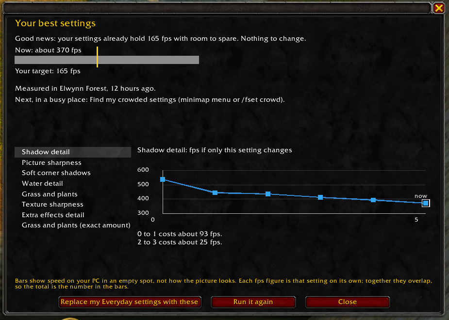
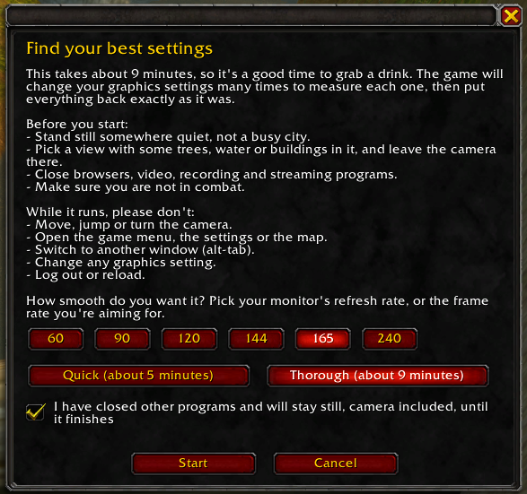
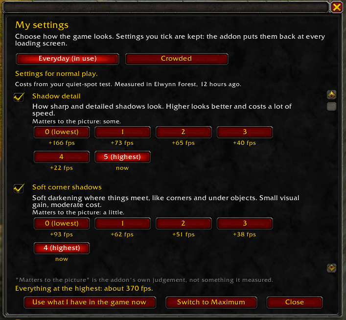
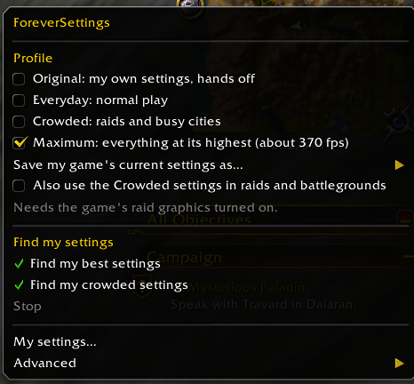

# ForeverSettings

**Not everyone has a beastmode PC. ForeverSettings finds the graphics settings that fit yours.**

<p align="center">
  
</p>

The graphics menu is a wall of sliders with names like "Compute effects" and "SSAO". Most of us either crank everything up and stutter in the busy places, or drop it all to Low and lose a beautiful game.

ForeverSettings measures *your* PC, tells you in plain words what each setting costs in frames per second, and picks settings for the frame rate you want. It shows you what you're giving up, so it's your call.

An addon for **WoW Forever**.

## Get it

- **Wago:** [addons.wago.io/addons/foreversettings](https://addons.wago.io/addons/foreversettings)
- **GitHub:** the zip on the [Releases page](../../releases/latest).
- **Install by hand:** unzip into the game's `Interface/AddOns` folder so you have one `ForeverSettings` folder (for Forever: `World of Warcraft/_forever_/Interface/AddOns/ForeverSettings`), then start the game or `/reload`. The details are in [INSTALL.md](INSTALL.md).

## Try it in four steps

1. Stand somewhere quiet and click the minimap button, then **Find my best settings**.
2. Pick the frame rate you're aiming for (your monitor's refresh rate is a good choice) and press **Start**. It takes roughly 5 to 10 minutes and runs on its own. Don't move or open windows while it runs.
3. See what each change does, then **Save**. Your own settings are put back after the test.
4. Later, in a busy place (a city, a raid): **Find my crowded settings**.

<p align="center">
  
</p>

## See the price of every level

**My settings** (minimap menu) lists every setting with what each level costs in frames per second against the level you have, how much it matters to the picture, and what everything at the highest would give.

<p align="center">
  
  &nbsp;&nbsp;
  
</p>

## Profiles

| Profile | What it is |
|---|---|
| **Original** | Your own settings, hands off. The addon records them before it first changes anything. Choose it to put everything back. |
| **Everyday** | The settings you saved for normal play. |
| **Crowded** | The settings you saved for raids and busy cities. |
| **Maximum** | Everything at the highest level the addon has learned. It needs plenty of graphics memory. |

Switch from the minimap button, or type `/fset profile everyday` (also `crowded`, `maximum`, `original`).

## Good to know

- Nothing is forced on a first install.
- It never changes a setting during combat or while a test is running.
- It doesn't collect or send anything.
- `/fset reset` puts back everything the addon changed. `/fset settings` opens My settings, and `/fset minimap` hides or shows the button.
- Built for and tried on WoW Forever. Retail is untested.

## Problems and ideas

Open an [issue](../../issues) with a screenshot and what you clicked. If a test stopped, the window says why; include that.

## For developers

The addon is Lua 5.1. The tests run under Node with [fengari](https://github.com/fengari-lua/fengari) against a simulated game (`tests/harness.lua`):

```
cd tests
npm install
bash run_all.sh --format-only       # TOC and file-format checks, seconds
node run.js . .. test_profiles.lua  # one suite
bash run_all.sh                     # every suite, then the mutation table (long)
```

`tests/run.js` also holds the mutation table: each rule in the code has a deliberate breakage that a named test must catch. `docs/specs/` holds the design specs. Releases are made by pushing a version tag; see [RELEASING.md](RELEASING.md).

## License

None chosen yet: all rights reserved until one is.
